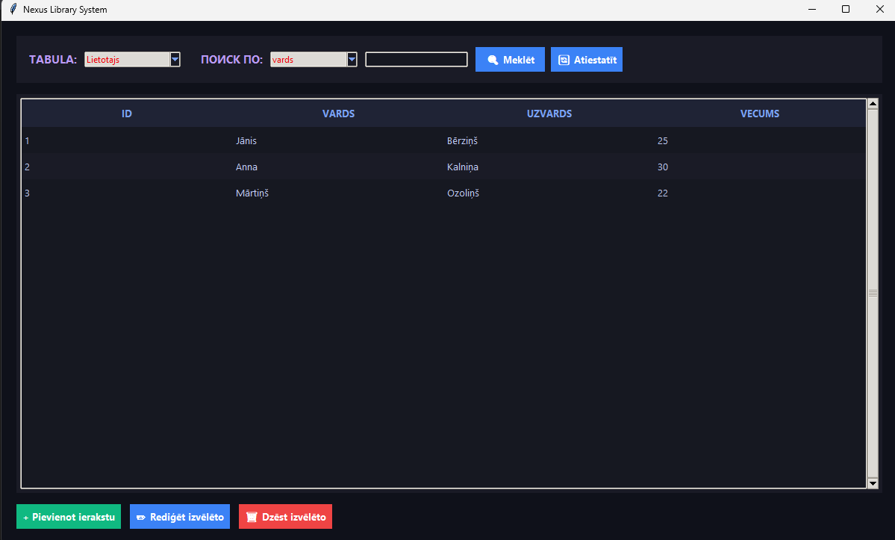
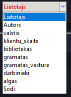
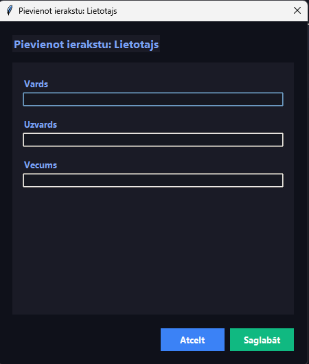

# Bibliotēkas Datu bāzes
Tas ir bibliotēkas datu bāze, kas glābj informāciju par klientiem, bibliotēkam, lai viegli būtu saprast kur, kurā bibliotēkā, kāda autora grāmata ir glābta un tas grāmatas saņemšanas/nodošanas vēsture.
## Description
Projekts izmanto SQL datu bāzi, lai strādātu.
## Kā palaist
Lejupielādējam mapi school-project-main, pēc tam palaižam failu app.py
## Lietojums
Palaižot app.py, jūs redzēsiet sākuma datu bāzi par Lietotājiem ar to informāciju.

Var apskatīt visas datu bāzes izvēloties tos pēc saraksta.

Var rediģēt, pievienot vai dzēst informāciju par datu bāzi.

Izvēloties pievienot, paradīsies logs, kur ir jāievieto informāciju par jaunu datu bāzes ierakstu.

Var meklēt ierakstu pēc informācijas un kategorijas.

## Contributing
Ja ir jautājumi, rakstiet man uz e-pastu: joeerto@gmail.com
## License
Licenzēts MIT License

## Contact
joeerto@gmail.com
* * *
